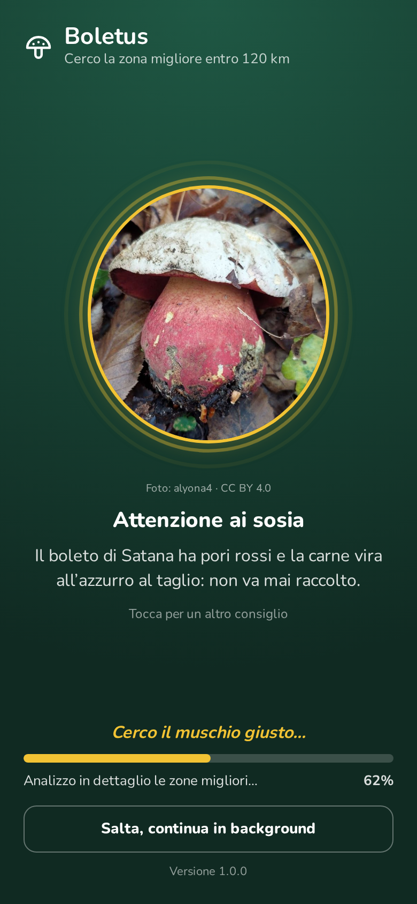
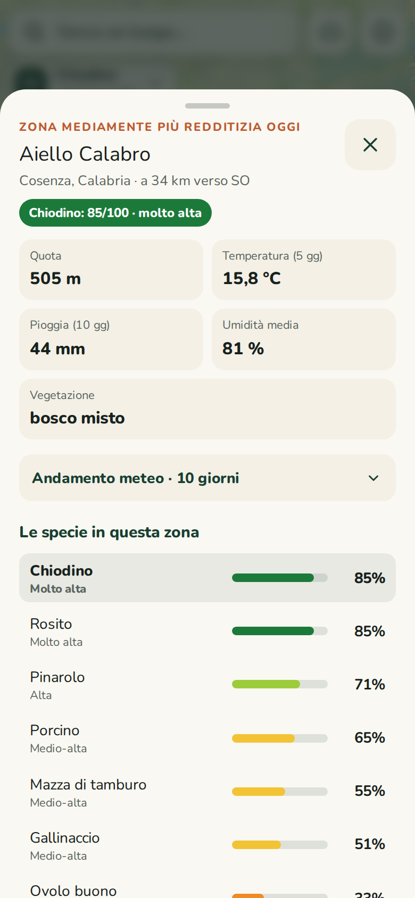
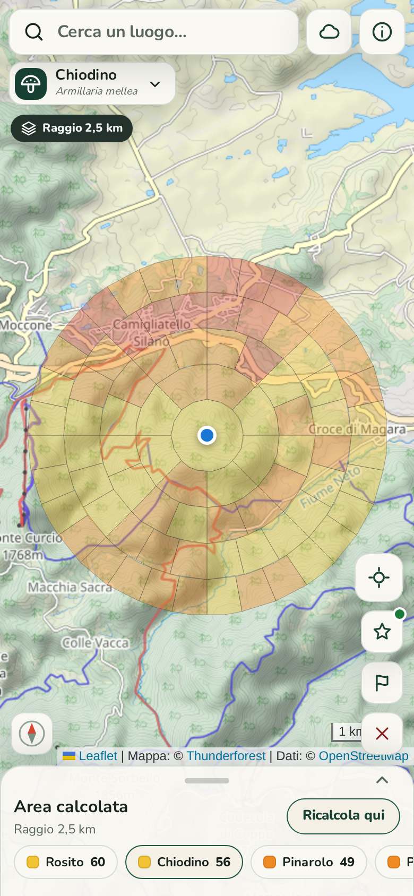
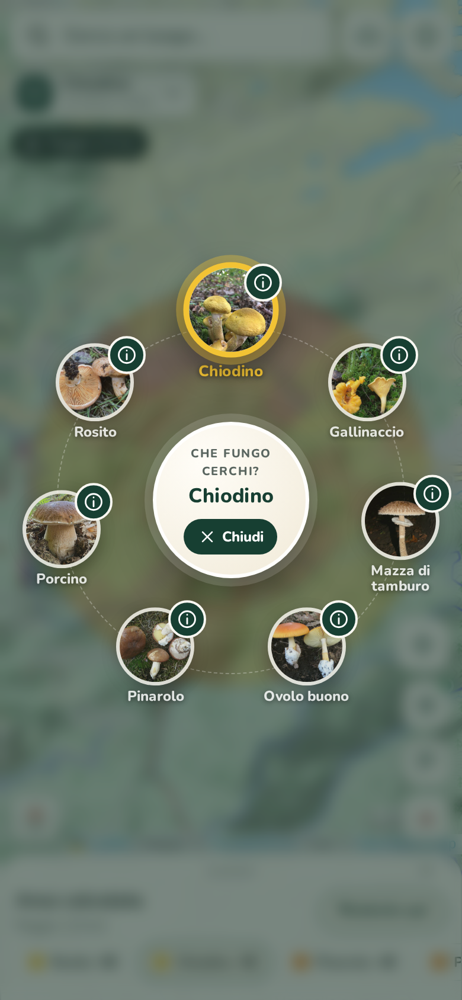
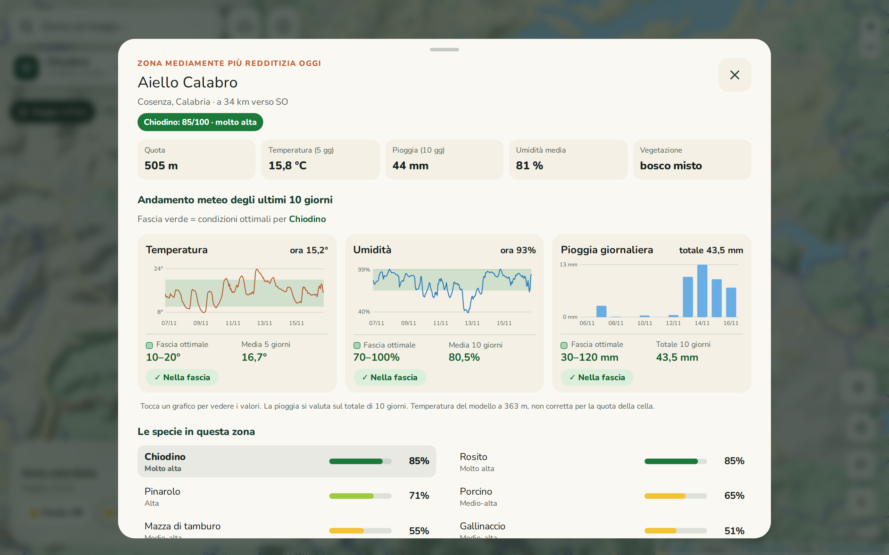

# 🍄 Boletus

**Dove vale la pena cercare funghi oggi?** Boletus guarda stagione, quota, temperatura, pioggia e umidità recenti e ti mostra su una mappa le zone più promettenti, per ogni specie. Nessun account, nessun server: i calcoli e i tuoi dati restano sul dispositivo.

> ⚠️ **Avvertenza**: Boletus indica solo *dove* potrebbe valere la pena cercare. **Non identifica i funghi e non ne garantisce la commestibilità**: fai sempre controllare il raccolto da un micologo o dall'ispettorato micologico della ASL e rispetta le norme locali sulla raccolta.

<table>
  <tr>
    <td align="center"><br><sub><b>All'avvio</b><br>analizza i 120 km attorno a te mentre leggi qualche consiglio (tocca per cambiarlo)</sub></td>
    <td align="center"><br><sub><b>La zona di oggi</b><br>dove andare e perché</sub></td>
    <td align="center"><br><sub><b>La mappa</b><br>probabilità cella per cella</sub></td>
  </tr>
  <tr>
    <td align="center"><br><sub><b>Il perché</b><br>tocca una cella per i motivi del punteggio</sub></td>
    <td align="center"><br><sub><b>Scegli il fungo</b><br>7 specie, con scheda e sosia</sub></td>
    <td></td>
  </tr>
</table>

<p align="center"><br><sub>Su desktop la scheda della zona include i grafici meteo degli ultimi 10 giorni.</sub></p>

## Cosa fa

- **Zona più redditizia del giorno**: una volta al giorno (e al primo avvio) analizza un raggio di 120 km attorno a te e ti propone la zona migliore, con il comune più vicino, la specie consigliata e i dati meteo che la giustificano. Mentre lavora, la schermata di caricamento mostra consigli con foto sui funghi e sulla sicurezza, che puoi sfogliare con un tocco.
- **Mappa di probabilità**: una griglia di 2,5 km di raggio, colorata da molto bassa a molto alta; tocca una cella per vedere cosa alza o abbassa il punteggio.
- **7 specie** con scheda informativa, foto e i sosia pericolosi da non confondere.
- **Punto di partenza**: lo salvi con un tocco e l'app ti dice distanza e direzione per tornarci, anche senza rete. Registra il percorso e, se manca il GPS, lo stima da passi e bussola.
- **Meteo e tramonto**: pannello con il meteo attuale e lo storico, più un avviso prima del tramonto.
- **Funziona offline**: mappa e dati già visti restano disponibili sul dispositivo.
- **Dove la usi**: nel browser (installabile come app sul computer) e come app Android.

## Come si calcola il punteggio (in breve)

Ogni fattore vale da 0 a 1 e si combina in un punteggio da 0 a 100:

```
punteggio = 100 × stagione × quota × vicinanza_abitato × media_pesata(temperatura, pioggia, umidità, vegetazione)
```

Stagione, quota e vicinanza ai centri abitati abbassano il punteggio in modo graduale, senza azzerarlo. Temperatura, pioggia e umidità sono quelle degli ultimi giorni. Le regole sono deterministiche (nessun machine learning) e vivono in file JSON per specie: i dettagli sono più in basso.

## Avvio in locale

Requisito: Node.js 20+.

```bash
make setup   # installa le dipendenze
make dev     # avvia il frontend su http://localhost:5173
make test    # test
make lint    # lint
make build   # build di produzione
```

Il GPS del browser funziona solo su `localhost` o in HTTPS. Variabili opzionali in `frontend/.env` (vedi `.env.example`): `VITE_THUNDERFOREST_API_KEY` per le mappe Thunderforest (senza chiave si usa OpenTopoMap) e `VITE_TILE_URL` per un altro provider.

### App Android

```bash
make apk
```

Compila il frontend, lo sincronizza con Capacitor e crea l'APK di debug in `frontend/android/app/build/outputs/apk/debug/app-debug.apk`. Servono JDK 21 e Android SDK (percorsi configurabili con `JAVA_HOME` e `ANDROID_HOME`). Per aprire il progetto in Android Studio: `cd frontend && npm run cap:android`.

## Architettura

```
boletus_app/
└── frontend/   React + TypeScript (Vite), Leaflet, Capacitor, Vitest
```

| Cartella (`frontend/src`) | Contenuto |
|---|---|
| `core/` | Logica pura in TypeScript, senza React né DOM, testata: geometria, punteggio, meteo, scansione dell'area, vegetazione |
| `data/species/` | Regole di ogni specie in JSON |
| `data/` | Schede delle specie, consigli e frasi del caricamento |
| `services/` | Adattatori: GPS, archivio locale, cache di mappe e dati, scansione dell'area |
| `hooks/`, `components/` | Interfaccia React |

Non c'è un backend: il calcolo avviene sul client e i dati dell'utente restano sul dispositivo.

**Dati esterni** (gratuiti, senza chiave):
- [Open-Meteo](https://open-meteo.com/): meteo degli ultimi 10 giorni, con cache e retry sui 429;
- [Terrain Tiles (Terrarium)](https://registry.opendata.aws/terrain-tiles/) su AWS: quote, lette nel browser dai pixel delle tile;
- [CORINE Land Cover 2018](https://land.copernicus.eu/pan-european/corine-land-cover) (Copernicus / EEA): boschi di conifere, latifoglie, misti, prati e centri abitati, a 100 m. Se non è disponibile il punteggio viene calcolato senza vegetazione;
- [Nominatim](https://nominatim.org/) (OpenStreetMap): nome del comune più vicino alla zona consigliata;
- [Thunderforest](https://www.thunderforest.com/) (Outdoors) o OpenTopoMap: tasselli della mappa.

### Zona più redditizia

Una volta al giorno l'app esegue una scansione in due fasi (`core/areaScan.ts`, `services/areaScan.ts`):

1. **Scansione grossolana**: un punto ogni 12 km entro 120 km (circa 320), con meteo, quota e stagione, valutando tutte le specie.
2. **Riesame**: le 3 zone migliori, distanti tra loro, vengono ricalcolate con la griglia da 2,5 km, vegetazione e distanza dagli abitati. Vince quella con il punteggio finale più alto; l'app ne scalda poi le cache e scarica le tessere della mappa attorno.

### Come si calcola il punteggio

Ogni fattore riceve un valore da 0 a 1 tramite una **curva trapezoidale** (`min`, `optMin`, `optMax`, `max`): vale 0 fuori dall'intervallo, 1 nella fascia ottimale e cresce o cala linearmente in mezzo.

```
moltiplicatore = 1 − influenza × (1 − valore)
```

- **Stagione**, **quota** e **vicinanza ai centri abitati** agiscono da moltiplicatori *non bloccanti*, con influenza 0,7, 0,5 e 0,4 (`scoring.ts`): un valore 0 riduce il punteggio rispettivamente al 30%, 50% e 60%. La stagione vale a metà mese e si interpola tra mesi adiacenti; la vicinanza vale 0 entro 200 m da un centro abitato e 1 oltre 1 km.
- **Temperatura** (media degli ultimi 5 giorni, corretta per la quota di ogni cella di −0,65 °C ogni 100 m), **pioggia** (totale degli ultimi 10 giorni) e **umidità** (media degli ultimi 10 giorni) si combinano con i pesi definiti nel JSON.
- **Vegetazione** (facoltativa per specie): l'habitat della cella (da CORINE) viene confrontato con le preferenze `weighted.habitat`. Se il dato manca, il fattore non entra nella media.
- **Bosco probabile** (solo Calabria): nei dettagli della cella compare una stima del tipo di bosco, ricavata da habitat e quota (`core/forestType.ts`). È un'euristica e non entra nel punteggio.
- Fasce: molto bassa (< 17), bassa (17–32), medio-bassa (33–49), medio-alta (50–65), alta (66–82), molto alta (≥ 83).
- Il meteo viene letto in un solo punto per griglia: pioggia e umidità sono uguali in tutte le celle, mentre quota e temperatura variano da cella a cella.

### Aggiungere una specie

Crea un file in `frontend/src/data/species/` (viene caricato e validato automaticamente):

```json
{
  "id": "mazza-di-tamburo",
  "name": "Mazza di tamburo",
  "latinName": "Macrolepiota procera",
  "blocking": {
    "season": [0, 0, 0, 0, 0, 0.5, 0.8, 1, 1, 1, 0.5, 0],
    "elevation": { "min": 0, "optMin": 100, "optMax": 1200, "max": 1800 }
  },
  "weighted": {
    "temperature": { "min": 8, "optMin": 14, "optMax": 24, "max": 30, "weight": 0.35 },
    "rain":        { "min": 5, "optMin": 30, "optMax": 100, "max": 220, "weight": 0.45 },
    "humidity":    { "min": 50, "optMin": 70, "optMax": 100, "max": 100, "weight": 0.2 }
  }
}
```

`season` contiene 12 valori tra 0 e 1, da gennaio a dicembre.

> I valori delle specie sono **segnaposto plausibili**, da validare con un esperto micologo.

## Roadmap

- [ ] Validare con un esperto le regole delle specie e aggiungerne altre
- [x] PWA e funzionamento offline (mappa in cache)
- [x] App Android con Capacitor: GPS nativo, tracciamento in background, bussola
- [x] Zona più redditizia del giorno
- [ ] Icone native Android e iOS
- [ ] Habitat più dettagliato (es. specie arboree: CORINE copre conifere/latifoglie/misti a 100 m)
- [ ] Segnalazione dei ritrovamenti
- [ ] Backend e deploy

## Licenza

Vedi [LICENSE](LICENSE).
