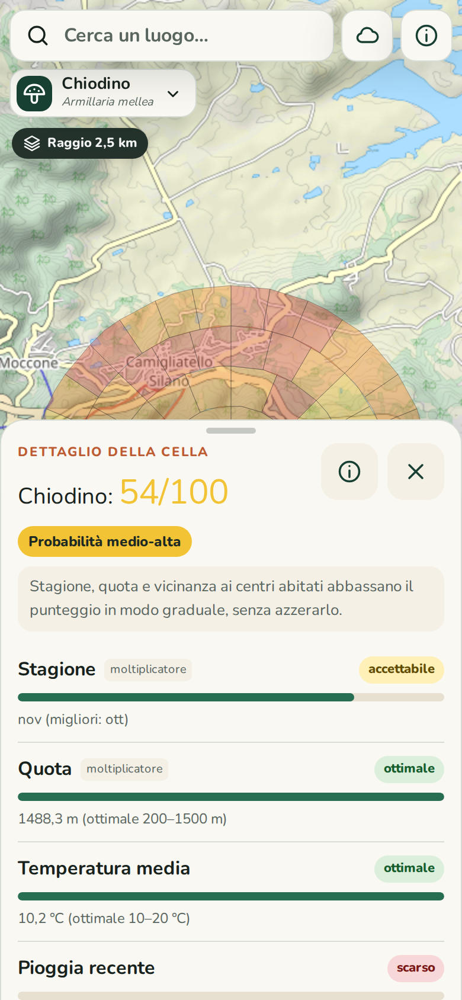
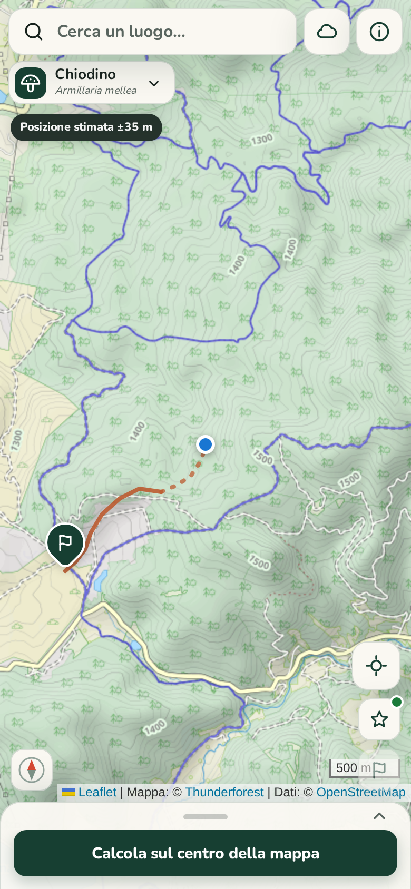
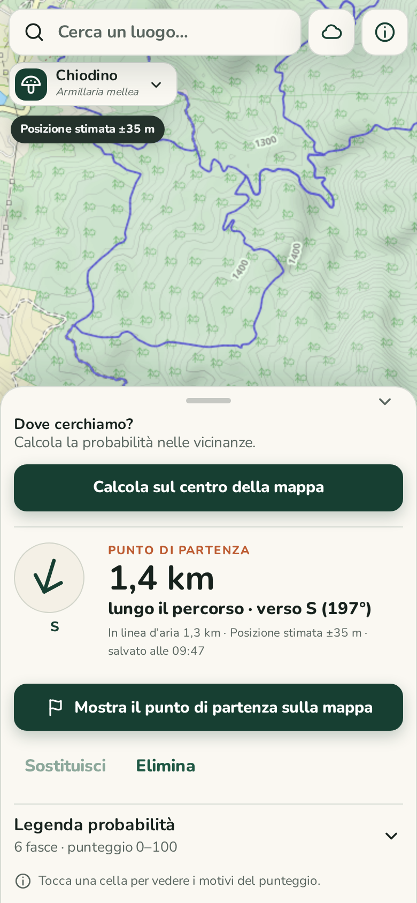

# Boletus

**Where is it worth looking for mushrooms today?** Boletus looks at the season, elevation and recent weather and shows you the most promising areas on a map, for each species.

## Why Boletus

Boletus started as a game. One day my father, a friend and I went mushroom hunting in the mountains and came back empty-handed. Talking it over, we realised there were two problems:

1. **We always go to the same known places**, partly so we don't get lost, and so we never try anywhere new.
2. **We don't know the ideal weather conditions.** Mushrooms depend on recent rain, temperature and humidity, and it is hard to tell by hand when and where they all line up.

Boletus tries to answer both: it suggests where to go today, even far from your usual spots, and explains why, based on the weather of the last days.

<table>
  <tr>
    <td align="center"> <b>Today's area</b> where to go and why</td>
    <td align="center"> <b>The map</b> probability cell by cell</td>
    <td align="center"> <b>The why</b> tap a cell to see what drives its score</td>
    <td align="center"> <b>Pick a mushroom</b> 7 species, with a profile and look-alikes</td>
  </tr>
</table>

## How tracking works

Mountain paths look the same in every direction, so Boletus helps you get back to where you started.

1. **Save your starting point**, for example where you parked the car.
2. **Walk and search.** The app draws your path on the map using the GPS (solid line).
3. **If the GPS drops** (dense forest, narrow valleys), the app keeps going by estimating your position from your steps and the compass (dotted line). The dashed circle shows how uncertain the estimate is: it grows the longer the GPS is missing, and the path snaps back to the real position as soon as the GPS returns.
4. **Head back** whenever you want: an arrow shows the direction and the distance to the starting point, following the path you have already walked rather than a straight line through the woods. It works without a signal, and tells you when you have arrived.

<table>
  <tr>
    <td align="center"> <b>On the map</b> solid line: GPS · dotted line: estimated from steps and compass</td>
    <td align="center"> <b>The way back</b> direction and distance along the path you walked</td>
  </tr>
</table>

## What you can do

- **Find today's best area**: on launch the app analyses the 120 km around you and suggests where to go, with the nearest town, the most likely mushroom and the weather behind it.
- **Read the map**: each cell is coloured from very low to very high probability; tap it to see what raises or lowers its score.
- **Pick a mushroom**: 7 species, each with a profile, photos and the dangerous look-alikes to avoid.
- **Find your way back**: save your starting point and the app shows distance and direction to return to it, even without a signal.
- **Keep an eye on weather and sunset**: current and recent weather, with a warning before sunset.
- **Learn while you wait**: tips with photos about mushrooms and safety scroll by during loading.
- **Use it offline**: maps and data you have already seen stay available.
- **Use it anywhere**: in the browser (installable as an app) and on Android.

## Development

Want to run it locally or build the Android app? See [docs/DEVELOPMENT.md](docs/DEVELOPMENT.md).

## License

Boletus is open source under the [MIT License](LICENSE), © 2026 Edoardo Misurelli. You are free to use, copy, modify and share it, as long as the copyright notice is kept.

The app is provided "as is", without any warranty: its suggestions are only a guide, and the author is not liable for how they are used.

**Credits for third-party material**
- **Mushroom photos** in the species profiles come from [Wikimedia Commons](https://commons.wikimedia.org/) and keep their own licenses (CC BY, CC BY-SA, CC0 or public domain). Author and license are shown in the app next to each photo.
- **Weather** by [Open-Meteo](https://open-meteo.com/), **elevation** from Terrain Tiles, **land cover** from [CORINE Land Cover](https://land.copernicus.eu/pan-european/corine-land-cover) (Copernicus / EEA) and **place names** from [Nominatim](https://nominatim.org/).
- **Maps** © [OpenStreetMap](https://www.openstreetmap.org/copyright) contributors, with tiles from Thunderforest or OpenTopoMap.
